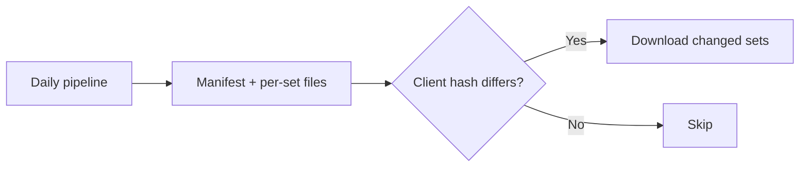

# Project Documentation

Write documentation that stays correct as the code evolves, and reads clearly the first time.
Documentation is in English, like the app.

## Layout

- `README.md` — what the project is, how to install and run it, where to go next. It links to
  `AGENTS.md`.
- `AGENTS.md` — instructions for coding agents, at the repo root.
- `docs/` — design notes that outlive a PR: architecture, core features, economy model.
- `docs/adr/NNNN-short-title.md` — one architecture decision per file, with the sections `Status`,
  `Context`, `Decision`, `Consequences`.

A choice settled in discussion becomes an ADR when the code starts depending on it.

## No Duplication

Every fact lives in exactly one place. If it exists elsewhere, link to it — never copy it.

```markdown
<!-- BAD: inline copy of a fact owned by another doc -->
The binary stores its database and image cache in the OS user config and cache directories.

<!-- GOOD: link to the single source of truth -->
Where the binary stores data is described in [Local storage](docs/architecture.md#local-storage).
```

## No Restated Rationale

If the same claim is argued in full more than once, state it once and link to it everywhere else.
A copy-pasted fact is easy to spot. The same conclusion re-justified in different words is not,
and it rots the same way when the reasoning changes.

```markdown
<!-- BAD: the same claim re-argued in three places -->
Section A: NPC simulation must replay missed ticks, otherwise prices freeze while the app is closed.
Section B: Because the app is not always running, we need catch-up ticks so the market keeps moving.
Section C: Catch-up is required since the market would otherwise stall between sessions.

<!-- GOOD: stated once, linked elsewhere -->
Section A (canonical): NPC simulation replays missed ticks, otherwise prices freeze while the app is closed.
Section B: Relies on catch-up ticks, see [Section A](#section-a).
```

## No File Listings

Do not paste `ls`/`tree` output. Describe purpose instead — readers can browse the repo.

````markdown
<!-- BAD: directory dump that rots the moment a file is added -->
```
internal/
├── domain/
├── store/
└── api/
```

<!-- GOOD: describe what the directories are for -->
`internal/domain` holds the game rules and imports no infrastructure. Persistence adapters live in `internal/store`.
````

## No Config Content Dumps

Do not paste YAML/TOML/JSON keys verbatim. Link to the file and explain the decision behind it.

````markdown
<!-- BAD: pasted config that drifts from reality -->
```yaml
builds:
  - env: [CGO_ENABLED=0]
    goos: [linux, darwin, windows]
```

<!-- GOOD: link + reasoning -->
Release targets live in [`.goreleaser.yaml`](../.goreleaser.yaml). CGO is disabled so every target cross-compiles from one runner.
````

## Single Decision Per ADR

An ADR records one decision. If a `## Decision` section reads as a numbered list of separable
rules, split it. Keep the decision the title names, extract every other one into its own ADR, and
leave a pointer where the extracted content was.

```markdown
<!-- BAD: three separable decisions under one title -->
# 0004 – Ledger Schema
## Decision
1. Coins are int64, not float.
2. The ledger is double-entry.
3. NPC trades are recorded in the same ledger as player trades.

<!-- GOOD: one decision here, the others linked out -->
# 0004 – Ledger Schema
## Decision
The ledger is double-entry: every transaction is a set of entries summing to zero.

| Topic      | Decision                                                             |
|------------|-----------------------------------------------------------------------|
| Coin type  | `int64`, never float — [ADR-0005](0005-coins-are-integers.md)         |
| NPC trades | Same ledger as the player — [ADR-0006](0006-npc-trades-in-ledger.md)  |
```

Never renumber an existing ADR. Numbers are permanent. Append extracted decisions after the
highest existing number, and leave the original ADR's `Decision`/`Consequences` pointing at them.

An accepted ADR is never amended or rewritten. To change a decision, write a new ADR that supersedes
it, and name the ADR it replaces in the new one's `Context`. The old ADR's `Status` line becomes
`Superseded by ADR-NNNN`, and nothing else in it changes.

## AGENTS.md

One `AGENTS.md` at the repo root, cross-linked from the README. See the
[AGENTS.md standard](https://agents.md/).

### Step 1 — Seed or update via the right tool, before any manual edits

- In Claude Code, run `/init` first, always. Manual edits made before `/init` are overwritten once
  it runs.
- In other agents, seed or update by analysing the repo: build, lint and test commands,
  architecture, key conventions.

### Step 2 — Revise the output

- Address coding agents broadly, not one tool.
- Fix architecture or documentation drift against the current code.
- Apply this skill's rules: no directory listings, no config dumps.
- Remove generic advice ("write unit tests", "never commit secrets"). Long repo-specific rules
  belong in a repo-local skill, not the always-loaded file.

## Single Source of Truth

If the project ever publishes a doc site, make `README.md` a symlink to `docs/index.md` so GitHub
and the site render the same content. Always use relative links between docs.

```markdown
<!-- BAD: absolute URL breaks on forks and local checkouts -->
See the [core features](https://github.com/foutoucour/crackapack/blob/main/docs/core-features.md).

<!-- GOOD: relative link works everywhere -->
See the [core features](docs/core-features.md).
```

## Diagrams

Use [Mermaid](https://mermaid.js.org/) in fenced ` ```mermaid ` blocks. Diagrams are source code:
version them, never paste exported PNGs. Screenshots of the real UI are the only exception.

````markdown

````

## Write Why, Not What

Code shows what. Docs explain why: the constraint, trade-off or decision a reader cannot infer
from the code.

```markdown
<!-- BAD: restates the code -->
The `ReplayTicks` function runs missed simulation ticks up to a cap of 7 days.

<!-- GOOD: explains the constraint -->
Catch-up is capped at 7 days because replaying months of NPC trades on launch would take minutes and flatten prices.
```

## Scannable Prose

A sentence with more than one parenthetical, or carrying two unrelated claims, gets skimmed. Split
it: a short lead sentence for the claim, then one sentence or sub-bullet per qualifier.
Reserve bold for structural signposts (**Pros:**/**Cons:**, the one claim a section is about).
Bold used for general emphasis trains readers to skip it.

```markdown
<!-- BAD: nested parentheticals, two unrelated claims -->
Scryfall prices (which update daily, but not for every printing) feed the NPC valuation
(confirmed for rares, unverified for promos), and the cache may be stale.

<!-- GOOD: one claim per sentence, qualifiers on their own lines -->
Scryfall prices feed the NPC valuation. They update daily, but not for every printing.
- Confirmed: rares carry a price.
- Not confirmed: whether promos do.
```

## Claims Must Survive Scrutiny

Before committing a claim, check three things.

- **Does the evidence carry the conclusion?** If a supporting example is weak, remove the
  conclusion built on it, everywhere it was restated. A retraction propagates.
- **Does the phrasing assert more certainty than was verified?** Prefer a vaguer true statement
  over a precise unverified one.
- **Is the example an instance of the claim?** A wrong example undermines the claim more than
  none. Cut it rather than force a fit.

```markdown
<!-- BAD: overstates what was verified -->
Every Time Spiral booster contains exactly one timeshifted card.

<!-- GOOD: states what the data actually shows -->
The MTGJSON booster definition for Time Spiral includes a timeshifted slot.
```

## Internal Cross-Reference Hygiene

Anchor links and backward references ("as described above") are invisible until someone clicks or
looks. Verify both before committing.

- An anchor matches a real heading's slug: lowercase, spaces to hyphens, punctuation stripped.
- A reference to "above", "below" or "earlier" points at content that exists. If it was cut or
  never written, write it or remove the reference.

## Pre-Commit Checklist

- One decision per ADR, see [Single Decision Per ADR](#single-decision-per-adr)
- `AGENTS.md` is cross-linked from `README.md`
- Every command and path in `README.md` and `AGENTS.md` exists and works
- No broken fenced code blocks
- No placeholder versions or `TODO` left in snippets
- Relative links resolve
- Anchors and backward references resolve, see
  [Internal Cross-Reference Hygiene](#internal-cross-reference-hygiene)
- No sentence carries more than one parenthetical or more than one distinct claim, see
  [Scannable Prose](#scannable-prose)
- No claim is argued in full more than once, see [No Restated Rationale](#no-restated-rationale)
- Every claim's evidence, phrasing and examples survive scrutiny, see
  [Claims Must Survive Scrutiny](#claims-must-survive-scrutiny)
