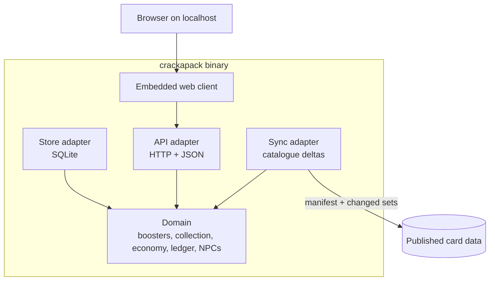

# Architecture

crackapack is a Go core with no UI, exposed through a JSON API, with a web client embedded in the
same binary. The goal is to defer the blocking choices — which UI, whether to go online — as late
as possible. What locks a project in is where the business logic lives, not which UI it uses.
So the logic lives in the core, and every UI is a replaceable client.

The language choice is recorded in [ADR-0001](adr/0001-go-for-the-core.md).

## Layers

The domain holds the rules: booster generation, collection, coins, the double-entry ledger and the
NPC simulation. It imports no infrastructure: no database, no HTTP, no filesystem, no clock, no
global randomness. Everything it needs arrives through interfaces it declares.

Adapters implement those interfaces and depend on the domain, never the reverse.

- The store adapter persists state in SQLite, through a pure-Go driver so the binary builds without
  CGO.
- The API adapter translates HTTP requests into domain calls and holds no business rules.
- The sync adapter keeps the local catalogue up to date, see [Data pipeline](data-pipeline.md).

`cmd/crackapack` is the only place where real adapters are built and wired together. `demo/` holds
the deterministic demo dataset. `tools/` holds Go programs run by CI, including the data pipeline.

## Local storage

The binary is separate from the player's data.

- The database lives under the OS user config directory.
- The image cache lives under the OS user cache directory.

Replacing or upgrading the binary never touches either.

## Time and the NPC market

The NPC market keeps moving while the app is closed. The simulation runs on a fixed tick with a
seeded random generator. On launch, it replays the ticks missed since the last session, with an
upper cap so that a long absence does not stall the start-up.

Because every random draw comes from an injected, seeded generator, a simulation run is
reproducible from its seed. That is what makes the economy debuggable and the demo deterministic.

## Going online later

Going online means deploying the same core as a server, and changing two adapters.

- The store moves from SQLite to a server database behind the same interfaces.
- The API gains authentication.

The web client keeps calling the same API. Draws stay server-side because the domain already owns
them. Nothing in the domain changes.

A native client, such as a game-engine front end, would be another client of the same API.
