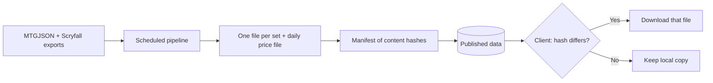

# Data pipeline

The client needs card data, booster collation rules and prices. The first launch downloads the
full catalogue once; later launches fetch only what changed, the way `git fetch` does.

## Sources

| Source | Provides | Licence |
|--------|----------|---------|
| [MTGJSON](https://mtgjson.com/) | Set contents, card identities, booster collation definitions | MIT |
| [Scryfall](https://scryfall.com/) | Card images, prices | See the open question below |

Cards are joined across the two sources by their shared UUIDs.

Neither source publishes deltas. Both publish full exports, so the deltas are built on our side.

## How updates reach the client

1. A scheduled GitHub Actions workflow downloads the exports and normalises them.
2. It writes one file per set and one price file per day, limited to the catalogue the app ships.
3. It publishes a manifest listing each file with its content hash.
4. On launch, the client downloads the manifest and fetches only the files whose hash changed.

The pipeline is Go code under `tools/`, run by the workflow. It does not live in the workflow's
shell steps.

## Images

Images are not part of the published data. The client downloads each image from Scryfall the first
time it is shown and caches it, see [Local storage](architecture.md#local-storage). Binders use the
small image size; the close-up view uses the large one.

## Open questions

- Scryfall's terms on redistributing data derived from their bulk exports must be checked before
  prices are republished. If they forbid it, the client fetches prices from Scryfall directly
  instead of from our published files.
