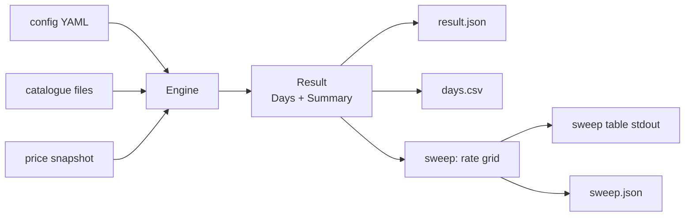

# Simulation guide

crackapack includes a headless simulation of the solo economy. It runs the real
domain logic — boosters, energy, the Counter, the coin ledger — without a UI or
real time. Time advances by ticks; a seeded generator makes every run reproducible.

## What it is for

The simulation lets maintainers tune the economy before releasing a change. Some
effects only show after weeks of play: the Counter's stock running dry, or a coin
rate that inflates the player's balance too fast. Playing through that is too slow;
the simulation runs it in seconds and compares the outcome to calibration targets.

The design is described in [Simulating the economy](specs-review.md#simulating-the-economy).
The inputs the simulation reads are defined in [Core features](core-features.md).

## Commands

Every subcommand accepts `--help` for detailed usage. Shell completion scripts
are available via `crackapack completion <shell>` (bash, zsh, fish, PowerShell).

### simulate

Run one solo-loop simulation and write results to a directory.

```
go run ./cmd/crackapack simulate \
  --catalogue-dir ./catalogues \
  --sets RAV,TSP \
  --supplementary TSB \
  --prices prices.json \
  --out ./out
```

Writes `result.json` (all metrics, one entry per day) and `days.csv`
(same data in tabular form) to `--out`.

### sweep

Run the simulation for each rate in the sweep grid, evaluate calibration targets
against each run, and report which rates pass.

```
go run ./cmd/crackapack sweep \
  --catalogue-dir ./catalogues \
  --sets RAV,TSP \
  --supplementary TSB \
  --prices prices.json \
  --out ./sweep-out
```

The sweep grid is taken from `sweep_rates` in the config file. Pass `--rates N,...`
to override it on the command line. Writes per-rate report files under `--out` and
a `sweep.json` aggregate, then prints the sweep table to stdout.

### compare

Compare two simulation results (JSON files produced by simulate or sweep).

```
go run ./cmd/crackapack compare before/result.json after/result.json
go run ./cmd/crackapack compare --days-csv delta.csv before/result.json after/result.json
go run ./cmd/crackapack compare before/result.json after/result.json --days-csv delta.csv
```

Reports which summary metrics changed and, optionally, the per-day delta as CSV.
Flags may appear before or after the positional file paths.

### demo

Run the sweep on the built-in synthetic demo dataset. No files or network needed.

```
go run ./cmd/crackapack demo
go run ./cmd/crackapack demo --out ./demo-out
go run ./cmd/crackapack demo --rates 100,200
```

The demo uses a fixed seed (42) so it is byte-identical on every run. Pass `--out`
to write the same per-rate reports as sweep. Pass `--rates` to override the default
grid (`[50, 100, 200, 400]`).

The demo runs in about one second. The binder milestones (`days_to_100pct_cu.*`) come
out identical at every rate on this dataset; the targets that split the grid are
`sub_coin_cards`, `daily_reward_commons` and `unsold_duplicate_copies`. Why the rate
leaves the milestones alone is explained in
[What the sweep answers](specs-review.md#what-the-sweep-answers-about-the-coin-rate).

## Input files

### Fetching real data

`tools/fetchdata` downloads the catalogue and price files from [MTGJSON](https://mtgjson.com)
on demand. Nothing is downloaded unless you run it.

```
go run ./tools/fetchdata --sets RAV,TSP,TSB
```

It writes `catalogues/<CODE>.json` for each set (override with `--catalogue-dir`) and a
`prices.json` snapshot (override with `--prices`). Pass them to the commands below with
`--catalogue-dir ./catalogues --prices prices.json`. Set codes are the MTGJSON ones; list a
supplementary pool such as `TSB` there too. Both default outputs are git-ignored.

The snapshot holds one price per card of the requested sets: the latest TCGplayer retail price in
US cents, non-foil first and foil for cards that exist only as foils. A card with no TCGplayer
price is left out, so the simulation prices it at `fallback_price` and counts it in
`unpriced_cards`.

Each run merges its prices into the `prices.json` that is already there, so the sets can be
downloaded in several calls.
- The prices of the sets of earlier calls stay as they were.
- A requested card takes its fresh price. One that has none now loses its old price.
- A `prices.json` the tool cannot decode stops the run and is left untouched.

Re-run the tool for a set to refresh its prices. The catalogue files are overwritten.

### Config YAML

All config keys and their defaults are listed in
[`internal/config/config.go`](../internal/config/config.go). The key groups:

| Group | Keys | Purpose |
|-------|------|---------|
| Economy | `coin_rate`, `counter_sell_pct`, `counter_buy_pct`, `counter_foil_pct`, `welcome_bonus`, `daily_reward` | Coin flow and Counter pricing; `counter_foil_pct` is the percentage of a card's price its foil is worth at the Counter, default 500, see [ADR-0027](adr/0027-a-foil-is-a-percentage-of-its-cards-price.md) |
| Energy | `energy.*` | Opening pace, coin fee on dear boosters, and optional coin top-up for missing energy; see [Energy](core-features.md#energy), [The coin fee on dear boosters](#the-coin-fee-on-dear-boosters) and [Energy coin top-up](#energy-coin-top-up) |
| Counter | `initial_stock`, `fallback_price`, `counter_shelf_days`, `counter_supply.*`, `counter_budget.*` | Starting inventory, price floor, how long sold cards stay and how the Counter stocks and pays for itself, see [The Counter's shelf life](#the-counters-shelf-life) and [The Counter as a special player](#the-counter-as-a-special-player) |
| NPCs | `npcs.population`, `npcs.max_margin_pct`, `npcs.archetypes.*` | The NPC crowd; see [NPC crowd](#npc-crowd) |
| Simulation | `sessions_per_day`, `run_days`, `seed` | Run parameters |
| Sweep | `sweep_rates`, `targets` | Grid and calibration conditions |

Omit the config file entirely to use all defaults. Only the keys you set are
overridden; every other key keeps its default value, and a key set to `null` counts as not set.

Loading rejects settings that would make a run meaningless, naming the key: `sessions_per_day`
above the 144 ticks of a day, an energy cost no larger reserve plus savings can pay
(`energy.cost_table[i].cost` above `reserve_cap + savings_cap`), and a `days_to_*` target whose
maximum exceeds `run_days`.

It also rejects:
- A numeric key above its upper bound, see [ADR-0014](adr/0014-numeric-config-keys-have-upper-bounds.md).
- A Counter energy whose `reserve_cap` cannot hold the dearest energy cost, savings not counting,
  see [ADR-0015](adr/0015-the-counters-reserve-must-hold-its-dearest-tier.md).
- A null item in a sequence, a float where an integer is expected and an unknown rarity under
  `initial_stock`, see [ADR-0017](adr/0017-config-input-is-strict.md).

A run fails at the start when a booster sheet holds a card that no loaded catalogue has, usually
because a supplementary pool such as TSB was not passed, see
[ADR-0016](adr/0016-a-run-fails-when-a-sheet-card-has-no-catalogue.md). A card that a foil sheet
holds loads with a foil finish even when MTGJSON lists it as non-foil only, see
[ADR-0028](adr/0028-a-foil-sheet-card-loads-with-a-foil-finish.md).

### Catalogue directory

A directory of MTGJSON v5 set files, one per set code (`RAV.json`, `TSP.json`,
…). Openable sets (passed via `--sets`) must have a `booster.draft` or a `booster.default` section.
Supplementary pools (`--supplementary`) do not require either. An openable set keeps only the cards
that a booster sheet contains, see [ADR-0007](adr/0007-catalogues-count-only-obtainable-cards.md).

A card is common, uncommon, rare, mythic or special, see
[ADR-0013](adr/0013-mythic-is-a-rarity-of-its-own.md). Any other rarity stops the run.

MTGJSON files for sets before Mirage (1996) have a `booster.default` and no `booster.draft`. The
loader reads the `default` one when there is no `draft`, see
[ADR-0020](adr/0020-a-set-file-booster-is-its-draft-or-default-definition.md). Whether those
definitions match the real boosters is unchecked, see
[Which sets can be simulated](specs-review.md#which-sets-can-be-simulated).

The directory also sets the reference of the energy cost tiers. A booster's cost is its average
value relative to the median over every openable set in the directory, not only the sets in `--sets`,
see [ADR-0008](adr/0008-energy-cost-reference-is-the-catalogue-directory.md).
- A file counts when it is named `<CODE>.json` with an upper-case code and has a `booster.draft` or
  `booster.default` section. Other files, such as `prices.json` or a pool without either like
  `TSB.json`, are skipped.
- A set file with any other defect, such as malformed JSON or an unknown rarity, stops the run with
  an error that names the file, even when it is not in `--sets`.
- `releaseDate` is optional. Only `focus_set: oldest` reads it, see [NPC crowd](#npc-crowd). A value
  that is not an ISO date such as `2005-10-07` is a defect.
- Compare runs on the same directory. Adding or removing a set file moves the median, and so every
  cost.

The price snapshot has to cover every set file of the directory. A set with no price in it would be
valued at `fallback_price` and pull the median down. `tools/fetchdata` merges each call into
`prices.json`, so fetch every set of the directory, in one call or several.

### Price snapshot JSON

A JSON object mapping MTGJSON UUID strings to integer prices in US cents:
`{"uuid": cents, ...}`. Cards absent from the snapshot fall back to
`fallback_price`.

## Reading the sweep table

The sweep prints a table with one row per rate and one column per calibration
target, plus the headline metrics `final_balance`, `sub_coin_cards`,
`daily_reward_commons` and `unsold_duplicate_copies` when they are not already
targets. Each target cell shows the metric value and `PASS` or `FAIL`.

The last line reports passing rates. When the passing rates form a contiguous block
in the grid, the report shows the range. When no rate passes, the line reads
"Passing rates: none". When no targets are configured, the line reads
"no targets configured".

`sweep.json` repeats the outcome for programs: the per-rate summaries and outcomes, the passing
rates, and `contiguous`, which is present (`true` or `false`) only when at least one rate passes.

## Summary metric names

`Summary` is a `map[string]float64` in the result JSON. All keys are lowercase
snake\_case; set-specific keys use the pattern `<name>.<setcode>` with the set
code lowercased.

A milestone not reached within the run is encoded as `float64(RunDays + 1)`, a censored value
above the run horizon. Config validation keeps it from passing by accident: an `at_most` or
`between` target on a `days_to_*` metric must have a maximum no greater than `run_days`.

| Metric | Definition |
|--------|-----------|
| `final_balance` | Player coin balance after the last day |
| `total_refused_trades` | Sum of sell attempts refused by the Counter (ErrSubCoin) across all days; volume signal for stuck inventory |
| `sub_coin_cards` | Distinct non-foil, non-basic-land cards, openable sets and supplementary pools included, that the Counter refuses to buy because the sale is worth less than one coin at the configured rate (a zero price counts); zero is the usual calibration target |
| `daily_reward_commons` | `floor(DailyReward / median_common_buy_coins)`; how many commons the daily reward buys at the Counter |
| `unpriced_cards` | Distinct non-basic-land cards, supplementary pools included, absent from the price snapshot and therefore priced at `fallback_price`; a count close to the whole catalogue means the snapshot is keyed wrongly |
| `unsold_duplicate_copies` | Copies above a playset (4) still held at the end of the run, whatever the policy's own keep count; non-zero when sub-coin cards cannot be sold |
| `days_to_50pct_cu.<setcode>` | First day (1-based) where the commons and uncommons owned reach 50% of the set's commons and uncommons |
| `days_to_100pct_cu.<setcode>` | First day (1-based) where every common and uncommon of the set is owned |
| `days_to_100pct.<setcode>` | First day (1-based) where every card of the set is owned: its whole binder. A set whose boosters draw from a supplementary pool counts those cards too: Time Spiral's binder is 402 cards, 281 of the set and 121 timeshifted, see [ADR-0037](adr/0037-a-binder-counts-the-pool-cards-its-boosters-draw.md) |
| `coins_after_full_binder` | Coins the player gains from the first day every openable set is complete to the end of the run; `0` when that day is never reached. It measures the coins that have nothing left to buy |
| `max_booster_wait_minutes` | Longest wait, from empty reserve and empty savings, to afford one booster of any openable set. It follows from the energy settings and does not depend on play |
| `booster_fee_coins` | Coin fees the player paid to open boosters over the run. Present only when `energy.coins_per_energy` is above zero |
| `coin_topup_units` | Energy units the player bought with coins (top-up) over the run. Present only when `energy.coin_topup.enabled` is true |
| `coin_topup_coins` | Coins paid into the coin top-up sink over the run. Present only when `energy.coin_topup.enabled` is true |
| `npc_boosters_opened` | Boosters the NPCs opened over the run. Present only when `npcs.population` is above zero |
| `npc_cards_sold` | Cards the NPCs sent to the Counter over the run. Present only with a crowd |
| `npc_cards_held` | Cards all NPC collections hold after the last day. Present only with a crowd |
| `counter_boosters_opened` | Boosters the Counter opened to stock itself over the run. Present only when it opens boosters |
| `counter_cards_opened` | Cards those boosters held, all put on the Counter's shelf. Present only when it opens boosters or has a treasury |
| `counter_fee_coins` | Coin fees the Counter paid from its treasury to open boosters. Present with the Counter metrics |
| `counter_broke_refusals` | Cards the Counter refused because its treasury could not pay, counted once per card and session. Present with the Counter metrics |
| `counter_treasury` | Coins in the treasury after the last day. Present with the Counter metrics |

Judge the pace of one set by running it alone, with `--sets RAV` for example. With several sets the
player shares energy between them, so every set takes longer. A set costs the same energy alone or
with others, because booster costs are relative to the median of the [catalogue directory](#catalogue-directory),
so `max_booster_wait_minutes` only changes when a set with a higher cost joins the run.

## Player policies

| Name | Behaviour |
|------|-----------|
| `collector` | Opens boosters for the set with the lowest C/U progress; sells duplicates above playset; buys missing non-foil cards cheapest-first up to a coin floor, the timeshifted cards of a Time Spiral binder included |
| `converting-collector` | Same as `collector` plus coin top-up in Phase 1: when short on energy, pays coins for the shortfall (no-op when `energy.coin_topup.enabled` is false). Raises the coin floor by the minimum booster fee so the fee buffer is never spent on card purchases. See [Energy coin top-up](#energy-coin-top-up) |
| `master-collector` | Plays like the `collector`, then spends the coins above the coin floor on the foil of every card it owns no foil of, cheapest first, skipping out-of-stock foils. The Counter stocks foils only from sales and from `counter_supply`, so a run needs that supply on. At the default `counter_foil_pct` of 500 foils are a coin sink |
| `cash-out` | Opens boosters, sells everything above one copy and never buys, so the run measures how many coins the Counter creates |
| `idle` | Does nothing, so only the NPCs act and the run measures the supply they send to the Counter |
| `trader` | Plays like the `collector` and also trades with NPCs, see [Trades](#trades) |
| `exploiter` | Plays like the `collector` and chains trades across every NPC looking for a gain, see [Trades](#trades) |

## The coin fee on dear boosters

A booster's energy cost stops at the dearest tier of the cost table, 12 energy by default. Past that
cap a booster keeps paying out more coins per energy, see
[Expensive old sets and the 12-energy cap](specs-review.md#expensive-old-sets-and-the-12-energy-cap).
The fee makes the player pay for the difference in coins, so a dear set cannot be farmed for the
price of 12 energy. The decision is recorded in
[ADR-0019](adr/0019-the-player-pays-a-coin-fee-on-boosters-above-the-energy-cap.md).

`energy.coins_per_energy`, the price `p` of one energy point, turns it on. A booster worth more than
the cap's energy costs the cap's energy and, in coins, its cash-out value minus the cap times `p`.
- The cash-out value is what the Counter would pay for the booster's cards, at `counter_sell_pct`.
- The fee goes from the player to the `booster_fee` account and leaves the economy.
- A booster worth no more than the cap times `p` pays no fee. At a `p` of 100 that is every
  2005-2007 set.
- The default 0 means no fee, and a run without one is the same as before the setting.

The fee is a price in coins, while a booster's value scales with `coin_rate`. A `p` that suits one
rate charges nothing at a lower rate and a lot at a higher one, so change them together.

The player pays the fee when it opens the booster. A player short of coins is refused and loses no
energy, just as one short of energy loses no coins. The `collector` and `cash-out` policies pass
over a set whose fee they cannot pay and open the next one, rather than wait on a booster they
cannot afford. The fees a set carries are in `WorldView.BoosterFees`.

A run with a fee adds `booster_fee_coins` to the summary and to `days.csv`, and `booster_fee` to the
money supply in `result.json`. `compare` refuses a run with a fee against one without, because their columns differ.

The Counter has the same rule with its own `p`, see
[The coin top-up and the treasury](#the-coin-top-up-and-the-treasury). Both read the fee from one
function, so a set costs the player and the Counter the same at the same `p`.

## Energy coin top-up

`energy.coin_topup.enabled` turns on optional coin top-up when opening a booster. When the player
has fewer energy units than the booster costs, they may pay coins for the shortfall at the rate
`energy.coins_per_energy` (p). The player must always provide at least `min_energy_units` real
energy — opening with coins only is never allowed. It is off by default, and a run without it is
unchanged. It needs `coins_per_energy > 0` to have any effect.

The top-up is gated by one of three variants:

| Variant | Config key | Behaviour |
|---------|-----------|-----------|
| `min_energy` (default) | `min_energy_units` | The player must supply at least `min_energy_units` real energy. Each shortfall unit costs exactly `p` coins. |
| `escalating` | `escalation_step` | The rate rises by `escalation_step` for each successive unit bought within a day. The k-th unit (0-indexed, counting from the start of the day) costs `p + k × escalation_step` coins. Resets at day start. Each unit costs at least `p`, so net worth never increases. |
| `both` | both keys | The minimum real-energy floor and the escalating rate both apply. |

```yaml
energy:
  coins_per_energy: 300
  coin_topup:
    enabled: true
    variant: min_energy      # "min_energy", "escalating", or "both"
    min_energy_units: 1      # minimum real energy required (all variants)
    escalation_step: 30      # rate increment per unit (escalating and both)
```

The `converting-collector` policy uses coin top-up. The `collector` and other built-in policies
ignore the top-up config. Run with `--player converting-collector` to observe the effect.

### Composition with the mandatory booster fee

The coin top-up and the mandatory booster fee (ADR-0019) are independent and compose:
- Top-up pays for missing energy units (shortfall between real energy and booster cost).
- The mandatory fee applies when the booster's value exceeds the 12-energy cap (`12 × p`); it equals `boosterValue − 12 × p`.
- The player must have enough coins to cover both in a single atomic open.

A run with coin top-up adds `coin_topup_units` and `coin_topup_coins` to the summary and
`days.csv`. `compare` refuses a run with top-up against one without, because their columns differ.

The invariant `coin_topup_coins ≥ coin_topup_units × p` holds for all variants (each unit costs at
least p; the escalating variant charges more for later units).

### Variant comparison on real catalogues

The tables below come from one-off `simulate` runs with `--player collector` and
`--player converting-collector`, one set per run, against a catalogue directory of 64 MTGJSON files
fetched with `tools/fetchdata`, so the energy tiers follow the median over the directory
([ADR-0008](adr/0008-energy-cost-reference-is-the-catalogue-directory.md)). A throwaway script
drove the runs and is not part of the repository. Configuration: p=100, coin\_rate=100, 90-day cap,
seeds 42/43/44 averaged, no NPCs, no trades, no Counter budget.

Set selection covers the three tiers of the cost table:
- **RAV** (782¢, energy=5, no fee at p=100): cheap, representative of 2005–2007 sets
- **TSP** (1026¢, energy=8, no fee at p=100): mid-tier
- **STH** (4833¢, energy=12, fee=3633 at p=100): expensive; the mandatory fee blocks the plain collector

The pacing goal from the todo is approximately 2 weeks at 3 sessions/day and 1 week at 6
sessions/day. Values are averages over 3 seeds.

**RAV — cheap, no fee (energy cost 5):**

| Policy | days\_to\_100pct | boosters | coin\_topup\_coins | final\_bal | coins\_after\_binder |
|--------|-----------------|----------|--------------------|-----------|----------------------|
| collector (no top-up), 3/day | 8.3 | 1,221 | 0 | 487,042 | 485,425 |
| conv-collector min\_energy, 3/day | 8.7 | 1,340 | 59,467 | 484,190 | 482,254 |
| conv-collector escalating, 3/day | 8.7 | 1,340 | 76,690 | 466,916 | 464,799 |
| conv-collector both, 3/day | 8.7 | 1,340 | 76,690 | 466,916 | 464,799 |
| collector (no top-up), 6/day | 6.7 | 1,583 | 0 | 660,131 | 657,144 |
| conv-collector min\_energy, 6/day | 6.7 | 1,618 | 17,500 | 659,816 | 657,256 |
| conv-collector escalating, 6/day | 6.7 | 1,618 | 18,383 | 658,932 | 656,423 |
| conv-collector both, 6/day | 6.7 | 1,618 | 18,383 | 658,932 | 656,423 |

**TSP — mid tier, no fee (energy cost 8):**

| Policy | days\_to\_100pct | boosters | coin\_topup\_coins | final\_bal | coins\_after\_binder |
|--------|-----------------|----------|--------------------|-----------|----------------------|
| collector (no top-up), 3/day | 11.0 | 763 | 0 | 331,888 | 329,923 |
| conv-collector min\_energy, 3/day | 10.7 | 804 | 32,867 | 324,422 | 323,561 |
| conv-collector escalating, 3/day | 10.7 | 804 | 37,807 | 319,482 | 318,726 |
| conv-collector both, 3/day | 10.7 | 804 | 37,807 | 319,482 | 318,726 |
| collector (no top-up), 6/day | 8.7 | 971 | 0 | 459,080 | 456,713 |
| conv-collector min\_energy, 6/day | 8.7 | 1,072 | 67,100 | 451,916 | 450,721 |
| conv-collector escalating, 6/day | 8.7 | 1,072 | 90,320 | 428,696 | 427,925 |
| conv-collector both, 6/day | 8.7 | 1,072 | 90,320 | 428,696 | 427,925 |

**STH — expensive, mandatory fee 3,633 coins at p=100 (energy cost 12):**

| Policy | days\_to\_100pct | boosters | coin\_topup\_coins | final\_bal |
|--------|-----------------|----------|--------------------|-----------|
| collector (no top-up), 3/day | >90 | 0 | 0 | 481 |
| conv-collector min\_energy, 3/day | >90 | 5 | 0 | 705 |
| collector (no top-up), 6/day | >90 | 0 | 0 | 481 |
| conv-collector min\_energy, 6/day | >90 | 5 | 0 | 705 |

**What the numbers say:**

1. *Does top-up make coins matter for pace?* Marginally. For RAV the converting-collector opens
   10% more boosters at 3/day but completes the binder 0.4 days *later* — the coin drain from
   top-up fees leaves fewer coins for Counter purchases, which are the primary completion mechanism.
   For TSP at 3/day it saves 0.3 days (10.7 vs 11.0) while opening 5% more boosters. At 6/day
   energy regenerates fast enough that top-up rarely triggers: both RAV and TSP finish at the same
   day count as the plain collector. The pacing goal (≈2 weeks at 3/day, ≈1 week at 6/day) is met
   by both policies for RAV and TSP.

2. *Does top-up shrink the idle coin pile?* Not meaningfully for cheap and mid sets. The
   converting-collector consumes 59K–90K coins in top-up fees over 90 days, but final balances
   remain in the 320K–660K range; top-up is at most 20% of total accumulation. The `escalating`
   variant drains more than `min_energy` (up to 90K vs 67K for TSP at 6/day) but still leaves
   a large idle pile.

3. *STH: the fee is the binding constraint, not energy.* The plain collector stalls because it
   never accumulates the 3,633-coin mandatory fee (WelcomeBonus=200, DailyReward=100 — the fee
   exceeds 30 days of income). The converting-collector's raised coin floor prevents spending the
   fee buffer on card purchases, so it saves up and opens 5 boosters in 90 days. `coin_topup_coins
   = 0` for those openings: the player had full real energy; the raised floor was what mattered,
   not top-up. The STH binder never completes at p=100; a higher `coin_rate` would be needed for
   the fee to become reachable within 90 days.

The stall fix is confirmed by the unit test `TestConvertingCollector_UnstallsOnRealCatalogues`,
which uses the real RAV+TSP+TSB catalogues: the `converting-collector` opens at least one booster
in 30 days at p=10, while the plain `collector` opens none.

### Demo configs for each variant

Three demo YAML snippets are bundled in `demo/config.go`. Each can be passed to `demo --config` or
used as a template for `simulate` and `sweep`:

| Exported constant | Variant | Extra keys |
|------------------|---------|-----------|
| `demo.DemoCoinTopupMinEnergyYAML` | `min_energy` | `min_energy_units: 1` |
| `demo.DemoCoinTopupEscalatingYAML` | `escalating` | `min_energy_units: 1`, `escalation_step: 30` |
| `demo.DemoCoinTopupBothYAML` | `both` | `min_energy_units: 1`, `escalation_step: 30` |

All three set `coins_per_energy: 300` and mirror the main demo config (90 days, seed 42, 70 NPCs,
the fixed Counter supply, and the same calibration targets). Pass `--player converting-collector`
when running them so the policy actually uses top-up each session.

## The Counter's shelf life

`counter_shelf_days` sets how long a card sold to the Counter stays in its stock. It is a feature
flag: the default `-1` keeps the Counter reselling what it buys, and a run with it is the same as
before it existed. Change one line in the config file to enable or disable it.

| Value | Meaning |
|-------|---------|
| `-1` | Cards stay forever. This is the default. |
| `0` | Cards vanish at once, so the Counter is a sink. |
| `N`, 1 or more | A card vanishes N days after it was sold. |

```yaml
counter_shelf_days: 2
```

The setting covers every card sold to the Counter, by the player or as NPC surplus. The player is
still paid for a sale, so coins are still created. A card the player bought from the Counter and
sells back goes on the shelf like any other.
- Initial stock never vanishes, since it is not a sold card.
- A purchase takes the oldest sold copy first, so the copies about to vanish are not wasted.
- A card sold at some tick vanishes exactly N days of ticks later.

A sale is permanent, and no player policy loses anything by it, see
[ADR-0018](adr/0018-cards-sold-to-the-counter-can-vanish.md). The collector, the trader and the
exploiter sell only above a playset, and the trader and the exploiter trade a duplicate before they
sell it. When the Counter has a treasury and cannot pay, the player offers it each card once per
session, not each copy: the other copies carry the same price and would be refused too.

With a crowd, the stock settles near the crowd's daily sales times N, so N becomes the dial of the
Counter's supply. With a sink or a short life the crowd stops flooding the Counter. A supply of
boosters opened by the Counter itself is not built yet, see
[TODO](todo.md#mechanics-not-simulated-yet-in-v1).

## The Counter as a special player

`counter_supply` lets the Counter open boosters to stock itself, as a player of its own. It is a
feature flag: the default mode `none` opens nothing, and a run with it is the same as before it
existed.

```yaml
counter_supply:
  mode: fixed
  boosters_per_day: 100
```

| Mode | The Counter |
|------|-------------|
| `none` | Opens nothing. This is the default. |
| `fixed` | Opens `boosters_per_day` boosters a day, spread over the day, with no energy. It picks the set uniformly. |
| `energy` | Opens a booster whenever its own energy pays the energy cost of the set it picked. |

In `energy` mode the Counter has an energy of its own, shaped like the player's and much larger. It
pays the same energy cost per set as the player, set by the
[cost table](core-features.md#energy), and the Counter's energy never feeds the player's.

```yaml
counter_supply:
  mode: energy
  energy:
    recharge_per_tick: 20
    reserve_cap: 100
    savings_interval_ticks: 1
    savings_cap: 1000
```

The Counter picks each set with a weight of one over its cost, so every set gets an equal share of
energy and a dear set is opened less often. A pick stays until its booster is opened, so a dear
set is not re-rolled while its energy builds up. The energy must be able to hold the dearest
tier, or the config is rejected. The values above are the defaults, and they are guesses.

The cards it opens go on its shelf like cards sold to it, so `counter_shelf_days` applies to them:
with `0` they vanish at once, and with a number of days they vanish after that long. Initial stock
still never vanishes.

### The coin top-up and the treasury

By default the Counter mints the coins it pays to the player. `counter_budget` gives it a finite
treasury instead, another feature flag that is off by default.

```yaml
counter_budget:
  enabled: true
  initial: 100000
  daily_float: 5000
```

With the budget on, the Counter pays the player from the treasury, and what the player pays for a
card goes into it. The treasury is a guarded account, so it never goes negative.
- **Broke Counter:** a sale the treasury cannot pay is refused and the card goes back to the player.
  It counts as a refusal, in `counter_broke_refusals`.
- **The float:** `initial` funds the treasury at the start and `daily_float` adds coins each day. They
  are the only new coins of a Counter with a budget.
- **Accounts:** `counter_treasury`, `counter_float` and `counter_fee` join the money supply of every
  day. `counter_sale` and `counter_purchase` stay at zero, since the treasury replaces them.

`counter_supply.coins_per_energy`, the price `p` of one energy point, adds a coin fee to the
boosters the Counter opens in `energy` mode. It needs the budget, because the treasury pays the
fee, and it is rejected without it. A booster worth more than the energy cap costs its cash-out
value, what the Counter would pay the player for its cards, minus the cap times `p`. The cap is
the dearest cost of the cost table. The fee goes from the treasury to `counter_fee` and leaves the
economy. A Counter whose treasury cannot pay the fee of a set picks another set the next tick.

The 2005-2007 sets pay no fee at a `p` of 100, since none is worth more than 12 energy at that
price. The player pays the same rule with its own `p`, see
[The coin fee on dear boosters](#the-coin-fee-on-dear-boosters). Neither pays coins for energy
itself: the fee is a price on a dear booster, and energy still cannot be bought.

The Counter draws on a random stream of its own, derived from `seed`. Adding a supply to a config
does not change what the player or the NPCs draw, so two runs that differ only by the supply stay
comparable. `compare` refuses a run that opens boosters against one that does not, because their
columns differ.

## NPC crowd

`npcs.population` sets the number of NPCs. It defaults to 0, and a run without NPCs is the same as
before the crowd existed: no NPC field appears in `result.json`, no NPC column in `days.csv` and no
`npc_*` metric in the summary. Which archetypes exist and what they stand for is described in
[NPCs and simulation](core-features.md#npcs-and-simulation).

Each tick, before the player's session, every NPC in ID order opens the boosters its rhythm has
come due for. A day's openings match its rhythm exactly, and an NPC never uses energy. Right after
each opening, the NPC sells the copy it just drew when it takes the NPC above its keep threshold.
The Counter takes it into stock without a ledger entry, because NPCs hold no coins.

An archetype is one YAML file in [`internal/config/archetypes`](../internal/config/archetypes),
embedded in the binary and read-only, see
[ADR-0023](adr/0023-archetypes-are-embedded-and-read-only.md). The file name is the archetype
name, and its keys are the ones of `ArchetypeConfig` in
[`internal/config/config.go`](../internal/config/config.go). Its shape is set by
[ADR-0021](adr/0021-an-archetype-names-a-base-behaviour-and-traits.md).

A config file passed to `simulate` or `sweep` can override an archetype under `npcs.archetypes`,
for calibration runs. An archetype you write there replaces the embedded one of the same name as a
whole, so every key of it must be set. A new name adds an archetype, and the others are kept.

An archetype can list `colors`, from W, U, B, R and G, with no repeat. An NPC then wishes only for
cards whose colours are all among its own, and colourless cards are always in scope, see
[ADR-0022](adr/0022-an-npc-wishes-only-for-cards-in-its-colours.md). An empty list, or all five
colours, means no restriction.

An archetype can also list `traits`, with the numbers each one reads under `trait_params`, see
[ADR-0021](adr/0021-an-archetype-names-a-base-behaviour-and-traits.md). `npcs.max_margin_pct`, 1000
by default, caps the margin an archetype's traits can add on top of its `margin_pct`. The cap never
lowers `margin_pct`, and a cap of 0 leaves traits no room. A config that lists an unknown trait is
rejected, with the known names in the error. Colours and traits take effect only when trades are
enabled, like the other trade keys.

Each NPC counts the declines it has had in a row: the player declines one of its offers or
counter-offers, or counters one and is refused on terms. An accepted trade resets the count, and an
expired offer leaves it alone. Traits that react to declines read it, see
[ADR-0024](adr/0024-a-decline-is-told-to-the-npcs-traits-and-counted.md).

The traits are listed below. A missing parameter takes the default in brackets, and an unknown
parameter or a negative value is rejected.

| Trait | Colour | What it does | `trait_params` |
|-------|--------|--------------|----------------|
| `stingy` | B | Adds margin that grows with the rarest card the NPC gives | `common_pct`, `uncommon_pct`, `rare_pct`, `special_pct`, `mythic_pct` (0) |
| `fish` | G | Ranks wishes by price, rarity and foil | `price_unit_cents` (100), `rarity_points` (0), `foil_points` (0) |
| `ego` | U | Adds margin for each day the oldest card it gives was held, refuses every player counter and proposes again after a decline | `max_retries` (3), `endowment_pct_per_day` (5) |
| `gambler` | R | Each decline in a row raises its offer chance and lowers its extra margin | `chance_step_pct` (4), `max_offer_chance_pct` (30), `margin_extra_pct` (15), `margin_step_pct` (5) |
| `archivist` | W | Ranks wishes toward older sets | none |

The ego proposes again after the player declines one of its own proposals. It makes at most
`max_retries` follow-ups a day, each a different trade from the declined ones, then holds for the
rest of the day, see [ADR-0025](adr/0025-an-npc-that-was-declined-proposes-again.md). The gambler's
offer chance rises by `chance_step_pct` per decline in a row, up to `max_offer_chance_pct`, and its
extra margin falls by `margin_step_pct` per decline, down to its `margin_pct`.

Trait margins price a player's proposal or counter. An NPC's own proposals use `margin_pct`, so a
stingy NPC's proposals do not carry the rarity add.

`focus_set` is `false`, `true` or `oldest`. `true` draws one set per NPC at generation, and `oldest`
gives every NPC the set with the earliest `releaseDate` among the loaded sets, see
[ADR-0026](adr/0026-focus-set-accepts-oldest.md). Which set that is depends on the sets you load.
`oldest` fails the run naming every set that has no `releaseDate`, but only when an archetype that
gets at least one NPC asks for it.

The archetypes `stingy`, `fish`, `ego`, `gambler` and `archivist` have a share of 4 each. The two
mixes, `ego_stingy` (U and B) and `archivist_ego_stingy` (W, U and B), have 3 and 2. All of these
numbers are assumptions to calibrate, and a run with a crowd includes these archetypes.

`ego_stingy` stacks stingy's rarity add and ego's endowment add on top of the base margin; it
vetoes every player counter. `archivist_ego_stingy` uses `focus_set: false` so the archivist trait
can rank wish candidates across all loaded sets by age; ego and stingy add margin only.

The archivist archetype itself has `focus_set: oldest` and no trait: every card in its scope shares
one release date, so the archivist wish-scorer cannot distinguish between sets there.

The crowd draws from its own random stream, derived from `seed`. The same seed still reproduces the
whole run. Adding NPCs to a config does not change what the player opens, so two runs that differ
only by the crowd stay comparable. The Counter's stock does change, and so can what a policy buys.

To measure supply alone, run the crowd without a player:

```
go run ./cmd/crackapack simulate \
  --catalogue-dir ./catalogues \
  --sets RAV,TSP \
  --supplementary TSB \
  --prices prices.json \
  --config npcs.yaml \
  --player idle \
  --out ./out
```

`compare` refuses a run with a crowd against a run without one, because their columns differ.

The archetype values in the embedded files are starting guesses. Offline catch-up and persistence are not
built, see [Specs review](specs-review.md#v1-scope-and-build-order).

## Trades

`trades.enabled` turns on trades between the player and the NPCs. It defaults to `false`, and a run
without trades is the same as before they existed: no `trade_*` column in `days.csv`, no `Trade`
block in `result.json`, and no `trade_*` metric in the summary. Trades need a crowd
(`npcs.population` above 0) and `npcs.surplus_hold_days` of at least 1. The rules are in
[Trades with NPCs](core-features.md#trades-with-npcs).

An NPC holds the copies above its keep threshold on a shelf for `npcs.surplus_hold_days` days
before selling them to the Counter, see [ADR-0011](adr/0011-npcs-hold-surplus-on-a-shelf.md). Only
the shelf can be traded. Each NPC has a wish list, and when a card on it is a duplicate of the
player's, the NPC may propose a swap. A duplicate is offered for once, and the NPCs that may propose
today are drawn in random order, so the daily cap favours no archetype. The player can also propose one to any NPC. An NPC accepts
when it receives at least the reference value it gives plus its margin, never negative. When an
offer falls short, the NPC counters once with the smallest coin top-up that fits, see
[ADR-0012](adr/0012-an-npc-counters-once.md). The coins the player adds go to the
`trade_topup` account, because NPCs hold no coins.

An archetype names a base trade behaviour, see
[ADR-0010](adr/0010-npc-trade-behaviour-is-a-strategy.md). Traits mix on top of it, see
[ADR-0021](adr/0021-an-archetype-names-a-base-behaviour-and-traits.md):

| Behaviour | Wishes for |
|-----------|------------|
| `casual` | Any card it lacks, at random |
| `playset_hunter` | Commons and uncommons, up to a playset, or up to its `keep_copies` when that is lower |
| `targeted_collector` | The cards it lacks, rarest first |
| `speculator` | The most valuable cards it lacks, and asks for the most valuable duplicates first |
| `whale` | Rares, mythics and specials, at random |

Every trade setting is a key of the configuration, so a scenario is a config file:

```yaml
npcs:
  population: 300
  surplus_hold_days: 2
  archetypes:
    speculator: {share: 10, min_boosters_per_day: 2, max_boosters_per_day: 4, keep_copies: 2,
                 behaviour: speculator, wish_size: 5, margin_pct: 25, offer_chance_pct: 1}
trades:
  enabled: true
  offer_expiry_days: 3
  max_cards_per_side: 10
  duplicate_keep: 1
  history_size: 0
  max_open_offers_per_day: 20
```

Run it with a player that trades:

```
go run ./cmd/crackapack simulate \
  --catalogue-dir ./catalogues --sets RAV,TSP --supplementary TSB \
  --prices prices.json --config trades.yaml --player trader --out ./out
```

Two policies trade, see `--player`:

- `trader` plays like the collector and also accepts NPC offers that bring a card it lacks, and
  swaps its duplicates for missing cards NPCs hold, paying a counter's top-up above the coin floor.
- `exploiter` chains trades across every NPC looking for a gain. It finds none: a test runs both
  policies for 30 days, at a margin of 0% and 10%, and checks that no proposal or acceptance raises
  the player's coins plus the reference value of its cards. A property test does the same for
  random offers straight against the Exchange. A counter-offer the exploiter will not accept is
  declined immediately, so open offers do not accumulate across sessions. A benchmark covers the
  high-session-rate case so the cliff cannot return unseen.

A run with trades adds these metrics, summed over the run in the summary and per day in
`days.csv`: `trade_player_proposals`, `trade_npc_offers`, `trade_accepted`, `trade_countered`,
`trade_refused`, `trade_expired`, `trade_volume_coins` and `trade_topup_coins`. `days.csv` also
gets the `trade_topup` balance. `compare` refuses a run with trades against one without.

Which of these settings move the economy and which do not is measured in
[What the NPC crowd and trades change](specs-review.md#what-the-npc-crowd-and-trades-change).

To see the cost of a long run, `go test ./internal/sim -run '^$' -bench BenchmarkRun -benchmem`
runs 90 days with 500 NPCs with and without trades. To check the exploiter's cost at the
formerly-slow config, run `go test ./internal/sim -run '^$' -bench BenchmarkExploiterHighSessionRate
-benchmem` (144 sessions/day, 30 NPCs, 10 days).

## Run diagram


