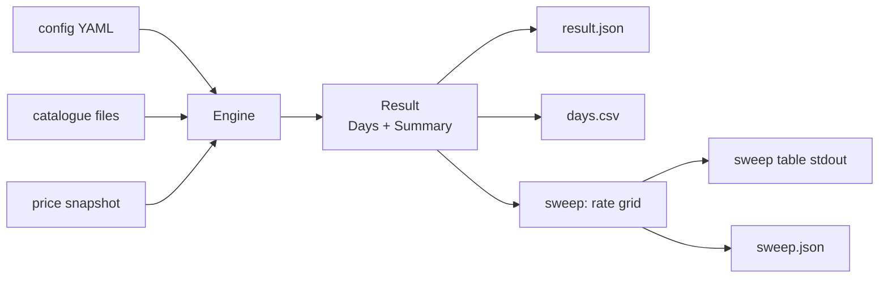

# Simulation guide

crackapack includes a headless simulation of the solo economy. It runs the real
domain logic — boosters, energy, the Counter, the coin ledger — without a UI or
real time. Time advances by ticks; a seeded generator makes every run reproducible.

## What it is for

The simulation lets maintainers tune the economy before releasing a change. Some
effects only show after weeks of play: the Counter's stock running dry, or a coin
rate that inflates the player's balance too fast. Playing through that is too slow;
the simulation runs it in seconds and compares the outcome to calibration targets.

The design is described in [Simulating the economy](specs-review.md#simulating-the-economy).
The inputs the simulation reads are defined in [Core features](core-features.md).

## Commands

Every subcommand accepts `--help` for detailed usage. Shell completion scripts
are available via `crackapack completion <shell>` (bash, zsh, fish, PowerShell).

### simulate

Run one solo-loop simulation and write results to a directory.

```
go run ./cmd/crackapack simulate \
  --catalogue-dir ./catalogues \
  --sets RAV,TSP \
  --supplementary TSB \
  --prices prices.json \
  --out ./out
```

Writes `result.json` (all metrics, one entry per day) and `days.csv`
(same data in tabular form) to `--out`.

### sweep

Run the simulation for each rate in the sweep grid, evaluate calibration targets
against each run, and report which rates pass.

```
go run ./cmd/crackapack sweep \
  --catalogue-dir ./catalogues \
  --sets RAV,TSP \
  --supplementary TSB \
  --prices prices.json \
  --out ./sweep-out
```

The sweep grid is taken from `sweep_rates` in the config file. Pass `--rates N,...`
to override it on the command line. Writes per-rate report files under `--out` and
a `sweep.json` aggregate, then prints the sweep table to stdout.

### compare

Compare two simulation results (JSON files produced by simulate or sweep).

```
go run ./cmd/crackapack compare before/result.json after/result.json
go run ./cmd/crackapack compare --days-csv delta.csv before/result.json after/result.json
go run ./cmd/crackapack compare before/result.json after/result.json --days-csv delta.csv
```

Reports which summary metrics changed and, optionally, the per-day delta as CSV.
Flags may appear before or after the positional file paths.

### demo

Run the sweep on the built-in synthetic demo dataset. No files or network needed.

```
go run ./cmd/crackapack demo
go run ./cmd/crackapack demo --out ./demo-out
go run ./cmd/crackapack demo --rates 100,200
```

The demo uses a fixed seed (42) so it is byte-identical on every run. Pass `--out`
to write the same per-rate reports as sweep. Pass `--rates` to override the default
grid (`[50, 100, 200, 400]`).

The demo runs in about one second. The binder milestones (`days_to_100pct_cu.*`) come
out identical at every rate on this dataset; the targets that split the grid are
`sub_coin_cards`, `daily_reward_commons` and `unsold_duplicate_copies`. Why the rate
leaves the milestones alone is explained in
[What the sweep answers](specs-review.md#what-the-sweep-answers-about-the-coin-rate).

## Input files

### Fetching real data

`tools/fetchdata` downloads the catalogue and price files from [MTGJSON](https://mtgjson.com)
on demand. Nothing is downloaded unless you run it.

```
go run ./tools/fetchdata --sets RAV,TSP,TSB
```

It writes `catalogues/<CODE>.json` for each set (override with `--catalogue-dir`) and a
`prices.json` snapshot (override with `--prices`). Pass them to the commands below with
`--catalogue-dir ./catalogues --prices prices.json`. Set codes are the MTGJSON ones; list a
supplementary pool such as `TSB` there too. Both default outputs are git-ignored.

The snapshot holds one price per card of the requested sets: the latest TCGplayer retail price in
US cents, non-foil first and foil for cards that exist only as foils. A card with no TCGplayer
price is left out, so the simulation prices it at `fallback_price` and counts it in
`unpriced_cards`. Re-run the tool to refresh the prices; it overwrites both outputs.

### Config YAML

All config keys and their defaults are listed in
[`internal/config/config.go`](../internal/config/config.go). The key groups:

| Group | Keys | Purpose |
|-------|------|---------|
| Economy | `coin_rate`, `counter_sell_pct`, `counter_buy_pct`, `welcome_bonus`, `daily_reward` | Coin flow and Counter pricing |
| Energy | `energy.*` | Opening pace; see [Energy](core-features.md#energy) |
| Counter | `initial_stock`, `fallback_price` | Starting inventory and price floor |
| Simulation | `sessions_per_day`, `run_days`, `seed` | Run parameters |
| Sweep | `sweep_rates`, `targets` | Grid and calibration conditions |

Omit the config file entirely to use all defaults. Only the keys you set are
overridden; every other key keeps its default value, and a key set to `null` counts as not set.

Loading rejects settings that would make a run meaningless, naming the key: `sessions_per_day`
above the 144 ticks of a day, an energy cost no larger reserve plus savings can pay
(`energy.cost_table[i].cost` above `reserve_cap + savings_cap`), and a `days_to_*` target whose
maximum exceeds `run_days`.

### Catalogue directory

A directory of MTGJSON v5 set files, one per set code (`RAV.json`, `TSP.json`,
…). Openable sets (passed via `--sets`) must have a `booster.draft` section.
Supplementary pools (`--supplementary`) do not require it. An openable set keeps only the cards
that a booster sheet contains, see [ADR-0007](adr/0007-catalogues-count-only-obtainable-cards.md).

The directory also sets the reference of the energy cost tiers. A booster's cost is its average
value relative to the median over every openable set in the directory, not only the sets in `--sets`,
see [ADR-0008](adr/0008-energy-cost-reference-is-the-catalogue-directory.md).
- A file counts when it is named `<CODE>.json` with an upper-case code and has a `booster.draft`
  section. Other files, such as `prices.json` or a pool without `booster.draft` like `TSB.json`, are
  skipped.
- A set file with any other defect, such as malformed JSON or an unknown rarity, stops the run with
  an error that names the file, even when it is not in `--sets`.
- Compare runs on the same directory. Adding or removing a set file moves the median, and so every
  cost.

### Price snapshot JSON

A JSON object mapping MTGJSON UUID strings to integer prices in US cents:
`{"uuid": cents, ...}`. Cards absent from the snapshot fall back to
`fallback_price`.

## Reading the sweep table

The sweep prints a table with one row per rate and one column per calibration
target, plus the headline metrics `final_balance`, `sub_coin_cards`,
`daily_reward_commons` and `unsold_duplicate_copies` when they are not already
targets. Each target cell shows the metric value and `PASS` or `FAIL`.

The last line reports passing rates. When the passing rates form a contiguous block
in the grid, the report shows the range. When no rate passes, the line reads
"Passing rates: none". When no targets are configured, the line reads
"no targets configured".

`sweep.json` repeats the outcome for programs: the per-rate summaries and outcomes, the passing
rates, and `contiguous`, which is present (`true` or `false`) only when at least one rate passes.

## Summary metric names

`Summary` is a `map[string]float64` in the result JSON. All keys are lowercase
snake\_case; set-specific keys use the pattern `<name>.<setcode>` with the set
code lowercased.

A milestone not reached within the run is encoded as `float64(RunDays + 1)`, a censored value
above the run horizon. Config validation keeps it from passing by accident: an `at_most` or
`between` target on a `days_to_*` metric must have a maximum no greater than `run_days`.

| Metric | Definition |
|--------|-----------|
| `final_balance` | Player coin balance after the last day |
| `total_refused_trades` | Sum of sell attempts refused by the Counter (ErrSubCoin) across all days; volume signal for stuck inventory |
| `sub_coin_cards` | Distinct non-foil, non-basic-land cards, openable sets and supplementary pools included, that the Counter refuses to buy because the sale is worth less than one coin at the configured rate (a zero price counts); zero is the usual calibration target |
| `daily_reward_commons` | `floor(DailyReward / median_common_buy_coins)`; how many commons the daily reward buys at the Counter |
| `unpriced_cards` | Distinct non-basic-land cards, supplementary pools included, absent from the price snapshot and therefore priced at `fallback_price`; a count close to the whole catalogue means the snapshot is keyed wrongly |
| `unsold_duplicate_copies` | Copies above a playset (4) still held at the end of the run, whatever the policy's own keep count; non-zero when sub-coin cards cannot be sold |
| `days_to_50pct_cu.<setcode>` | First day (1-based) where the commons and uncommons owned reach 50% of the set's commons and uncommons |
| `days_to_100pct_cu.<setcode>` | First day (1-based) where every common and uncommon of the set is owned |
| `days_to_100pct.<setcode>` | First day (1-based) where every card of the set is owned: its whole binder |
| `coins_after_full_binder` | Coins the player gains from the first day every openable set is complete to the end of the run; `0` when that day is never reached. It measures the coins that have nothing left to buy |
| `max_booster_wait_minutes` | Longest wait, from empty reserve and empty savings, to afford one booster of any openable set. It follows from the energy settings and does not depend on play |

Judge the pace of one set by running it alone, with `--sets RAV` for example. With several sets the
player shares energy between them, so every set takes longer. A set costs the same energy alone or
with others, because booster costs are relative to the median of the [catalogue directory](#catalogue-directory),
so `max_booster_wait_minutes` only changes when a set with a higher cost joins the run.

## Player policies

| Name | Behaviour |
|------|-----------|
| `collector` | Opens boosters for the set with the lowest C/U progress; sells duplicates above playset; buys missing non-foil cards cheapest-first up to a coin floor |
| `cash-out` | Opens boosters, sells everything above one copy and never buys, so the run measures how many coins the Counter creates |

## Run diagram


